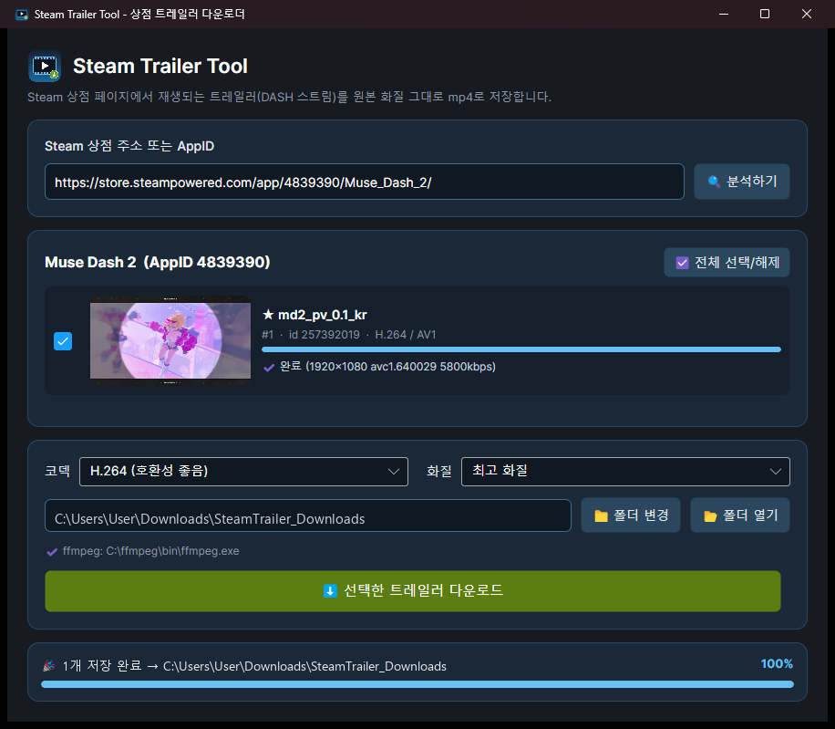

# Steam Trailer Tool (`steam trailer tool`)

<div align="center">


<br/><br/>

<!-- 배지는 GitHub 이미지 프록시(camo) 504를 피하려고 shields.io SVG를 docs/badges에 저장해 사용 -->


<p>
  <strong>Steam 상점 페이지에서 재생되는 트레일러를 원본 화질 그대로(재인코딩 없이) mp4로 저장하는 다운로더</strong>
</p>



</div>

---

## ✨ 주요 기능

- 🔗 **주소 하나로 끝**: 상점 주소(`https://store.steampowered.com/app/4839390/Muse_Dash_2/`) 또는 AppID(`4839390`)만 넣으면 해당 게임의 트레일러 목록과 썸네일을 불러옵니다.
  - `steamcommunity.com/app/…`, `steamdb.info/app/…`, 연령 확인(`agecheck`) 주소도 인식합니다.
  - **출시 예정 게임**의 트레일러도 받을 수 있습니다.
- 🎞️ **원본 화질 무손실 저장**: Steam이 실제로 송출하는 DASH 스트림(최대 1080p60)을 받아 `ffmpeg -c copy`로 영상+음성을 합칩니다. 다시 인코딩하지 않으므로 화질 손실이 없습니다.
- 🎚️ **코덱·화질 선택**
  - **H.264**: 어디서나 재생되는 호환성 우선 (기본값)
  - **AV1**: 같은 화질에서 용량 약 절반
  - 화질 상한: 최고 / 1080p / 720p / 480p / 360p
- ☑️ **선택 다운로드 & 취소**: 트레일러별 체크·진행률 표시, 언제든 `[⏹ 취소]` 가능.
- 🚀 **빠르고 안전한 다운로드**
  - 3초 단위 세그먼트를 슬라이딩 윈도우로 **병렬 요청하되 순서대로 기록**합니다.
  - 세그먼트별 자동 재시도(5xx·429·네트워크 오류, 지수 백오프).
  - `.part` 임시 파일에 받은 뒤 완료 시에만 최종 파일로 교체해, 중간에 끊겨도 깨진 mp4가 남지 않습니다.
- 🧰 **ffmpeg 없어도 동작**: ffmpeg가 없으면 `….video.mp4`와 `….audio.m4a`를 따로 저장합니다(둘 다 단독 재생 가능).
- ⌨️ **CLI 버전 포함**: `steam-trailer.exe`로 스크립트·일괄 작업 가능.

저장 위치 기본값은 `%USERPROFILE%\Downloads\SteamTrailer_Downloads`, 파일명은 `게임명 - 트레일러명 [1080p H264].mp4` 형식입니다.

---

## 📥 사용법

### GUI

1. 상점 주소 또는 AppID 입력 → **🔍 분석하기** (Enter 키도 가능)
2. 받을 트레일러 체크, 코덱·화질·저장 폴더 선택
3. **⬇ 선택한 트레일러 다운로드**

### CLI

```powershell
steam-trailer https://store.steampowered.com/app/4839390/Muse_Dash_2/
steam-trailer 4839390 --codec av1 -q 720 -o D:\Trailers
steam-trailer 4839390 --list
```

| 옵션 | 설명 |
| --- | --- |
| `-o, --out <폴더>` | 저장 폴더 (기본: `%USERPROFILE%\Downloads\SteamTrailer_Downloads`) |
| `-c, --codec <h264\|av1>` | 영상 코덱 (기본: `h264`) |
| `-q, --max-height <N>` | 최대 세로 해상도, 예: `1080`, `720` (기본: 최고 화질) |
| `-i, --index <목록>` | 받을 트레일러 번호 (1부터, 쉼표 구분). 기본: 전부 |
| `-l, --list` | 목록·화질만 출력하고 다운로드하지 않음 |
| `--lang <언어>` | Steam 언어 코드 (기본: `koreana`) |

### ffmpeg

영상·음성을 한 파일로 합치려면 ffmpeg가 필요합니다. 다음 순서로 찾습니다.

1. `FFMPEG_PATH` 환경 변수 (파일 또는 폴더)
2. 실행 파일과 같은 폴더의 `ffmpeg.exe`
3. `PATH`

---

## ⚙️ 동작 원리

```
상점 주소/AppID
   └─▶ store.steampowered.com/api/appdetails  (filters=basic,movies)
          └─▶ movies[].dash_h264 / dash_av1  (MPEG-DASH .mpd)
                 └─▶ 최고 화질 영상 + 최고 음질 음성 Representation 선택
                        └─▶ init + chunk-00001…N.m4s 병렬 다운로드 → 트랙별 fMP4
                               └─▶ ffmpeg -c copy 병합 → 게임명 - 트레일러명 [1080p H264].mp4
```

상점 페이지 HTML은 스크립트로 렌더링되어 영상 주소가 들어 있지 않기 때문에, Steam 공개 API(`appdetails`)를 사용합니다.

---

## 🛠️ 기술 스택

- **Framework**: [.NET 10.0](https://dotnet.microsoft.com/)
- **UI**: [Avalonia UI 12.0.5](https://avaloniaui.net/) + [CommunityToolkit.Mvvm 8.4.2](https://learn.microsoft.com/dotnet/communitytoolkit/mvvm/)
- **Test**: [xUnit 2.9.3](https://xunit.net/)
- 외부 다운로드 라이브러리 없이 MPD 파서·세그먼트 다운로더를 직접 구현

| 프로젝트 | 내용 |
| --- | --- |
| `SteamTrailerTool.Core` | Steam API 조회, DASH(MPD) 파서, 세그먼트 다운로더, ffmpeg 병합 |
| `steam trailer tool` | Avalonia GUI (`steam trailer tool.exe`) |
| `SteamTrailerTool.Cli` | 콘솔 버전 (`steam-trailer.exe`) |
| `SteamTrailerTool.Tests` | xUnit 단위 테스트 |

---

## 🚀 빌드 및 실행

```powershell
# 실행
dotnet run --project "steam trailer tool/steam trailer tool.csproj"
dotnet run --project SteamTrailerTool.Cli -- 4839390

# 전체 빌드 + 테스트
dotnet build "steam trailer tool.slnx"
dotnet test SteamTrailerTool.Tests

# 단독 실행 파일(Single-File Self-Contained EXE) 패키징 → publish\
dotnet publish "steam trailer tool/steam trailer tool.csproj" -c Release -o publish
dotnet publish SteamTrailerTool.Cli -c Release -o publish
```

자세한 설계 의도와 시행착오 기록은 [AGENTS.md](AGENTS.md)를 참고하세요.

---

> ⚠️ 트레일러의 저작권은 각 게임의 개발사·배급사에 있습니다. 개인 보관·참고 용도로만 사용하세요.
